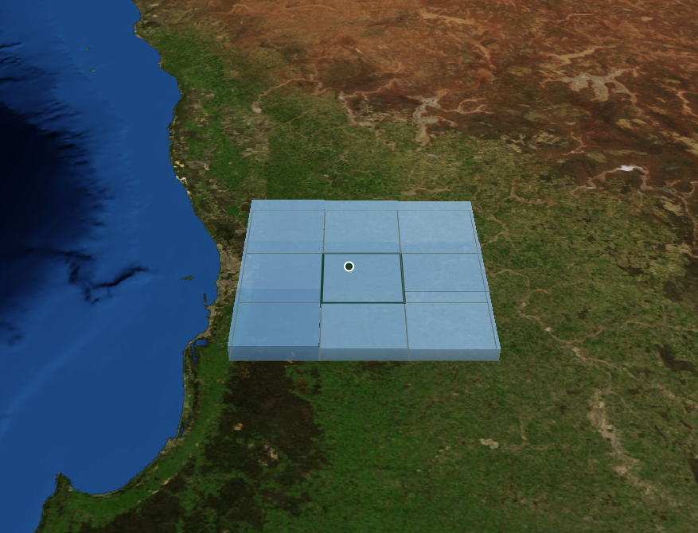
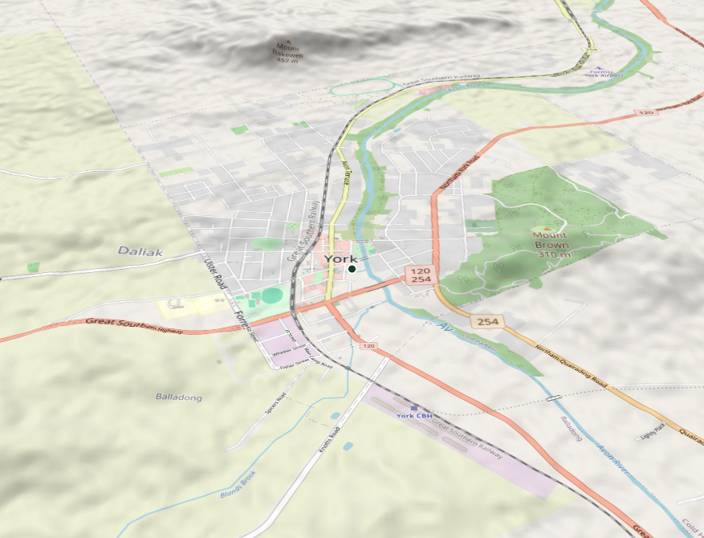
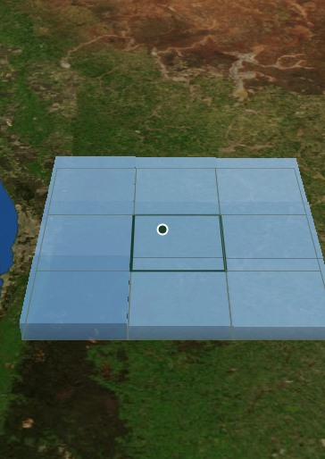
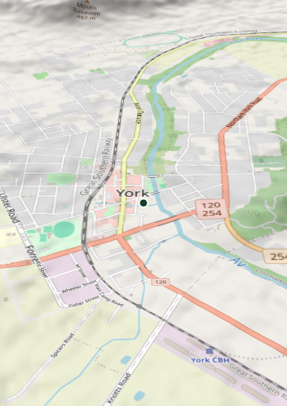

# 3D visual review - preview only

**Approved by the user on 15 November 2026 for preview.** This does not approve a production change or waive the failed live-field release gate.

These are actual application renders from 15 November 2026. The app keeps Leaflet 2D as its default. Production is frozen. This review approves the functional visual direction only; the mandatory live-field/release checks and external preview verification remain separate.

The images below capture the full GPU canvas to avoid cropping inside the phone scroll container. The running app supplies adjacent controls, dated legends, exact tables and source attribution.

## 1280-pixel viewport

June 2025 · rain sum of available days (mm). Colour: pale blue 0 to dark blue 161.68 mm, fixed across this year. Height: 1 mm = 123.7 display metres; columns are not water depth. Hatched cells have no available rain values; partial totals are labelled in the table.

Basemap: NASA GIBS Blue Marble static composite (no observation date supplied). Rain: NASA POWER / MERRA-2 historical regional estimates, not field measurements. Renderer: MapLibre GL JS.

Terrain display exaggeration is x1. Basemap credits: OpenStreetMap contributors, ODbL 1.0. Terrain Tiles source-specific attribution is shipped in public/licenses/terrain-attribution.txt, including NASA/USGS SRTM where supplied. A point is selected; field slope/aspect remain unassessed without a live-returned boundary.

Nearest DEM pixel at the selected point: 178.0 m. Sampling spacing approximately 32.4 m/pixel. This is modelled terrain, not a survey. Field slope and aspect require a boundary.

Terrain Tiles Terrarium DEM mosaic · estimated context. Observation/acquisition date: unknown or varies by source. DEM tile zoom 12.

Historical DEM mosaic including SRTM and other providers, not a surveyed farm height or current observation.
Tile sampling spacing is not source accuracy. Elevation datum, source resolution and age can vary.
Slope uses central differences of unexaggerated elevation and neighbouring pixels; aspect is downhill, clockwise from north.
Only DEM pixel centres inside the supplied polygon, excluding holes, are summarised. Boundaries are approximate.
Transparent and lowest encoded elevation pixels remain missing. Fewer than nine valid interior gradients leave slope/aspect unassessed.
Terrain is context only: no erosion prediction, crop suitability, ownership or access is established.
srtm/S32E116.tif · retrieved 2026-11-15T08:13:17.919Z · tile-file modification Mon, 20 Nov 2017 04:14:12 GMT (not observation date)
Full terrain-provider attribution

## 390-pixel viewport

June 2025 · rain sum of available days (mm). Colour: pale blue 0 to dark blue 161.68 mm, fixed across this year. Height: 1 mm = 123.7 display metres; columns are not water depth. Hatched cells have no available rain values; partial totals are labelled in the table.

Basemap: NASA GIBS Blue Marble static composite (no observation date supplied). Rain: NASA POWER / MERRA-2 historical regional estimates, not field measurements. Renderer: MapLibre GL JS.

Terrain display exaggeration is x1. Basemap credits: OpenStreetMap contributors, ODbL 1.0. Terrain Tiles source-specific attribution is shipped in public/licenses/terrain-attribution.txt, including NASA/USGS SRTM where supplied. A point is selected; field slope/aspect remain unassessed without a live-returned boundary.

Nearest DEM pixel at the selected point: 178.0 m. Sampling spacing approximately 32.4 m/pixel. This is modelled terrain, not a survey. Field slope and aspect require a boundary.

Terrain Tiles Terrarium DEM mosaic · estimated context. Observation/acquisition date: unknown or varies by source. DEM tile zoom 12.

Historical DEM mosaic including SRTM and other providers, not a surveyed farm height or current observation.
Tile sampling spacing is not source accuracy. Elevation datum, source resolution and age can vary.
Slope uses central differences of unexaggerated elevation and neighbouring pixels; aspect is downhill, clockwise from north.
Only DEM pixel centres inside the supplied polygon, excluding holes, are summarised. Boundaries are approximate.
Transparent and lowest encoded elevation pixels remain missing. Fewer than nine valid interior gradients leave slope/aspect unassessed.
Terrain is context only: no erosion prediction, crop suitability, ownership or access is established.
srtm/S32E116.tif · retrieved 2026-11-15T08:13:22.303Z · tile-file modification Mon, 20 Nov 2017 04:14:12 GMT (not observation date)
Full terrain-provider attribution

## Crop window and controls

[Crop-window UI](evidence/v5-window-static-desktop.png) shows the actual 80-day cabbage assessment, its exact historical analogue and the separate monthly-view return. The paused monthly control is hidden to avoid suggesting that January is the displayed crop window. [Phone controls](evidence/v5-controls-static-mobile.png) show the existing forest/cream native controls.

Reproduce with npm run build, then node scripts/capture-3d-review.js. [Raw render metadata](evidence/v5-visual-review.json). These are desktop Chrome renders at two viewport sizes, not real-phone measurements.
